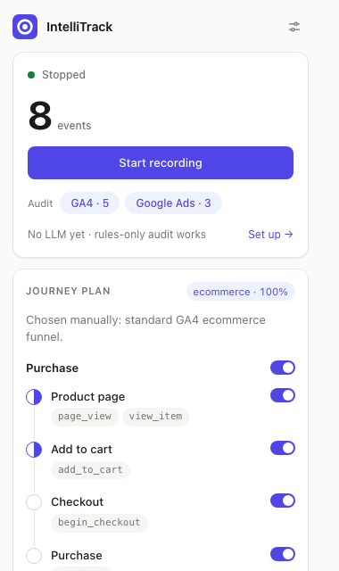
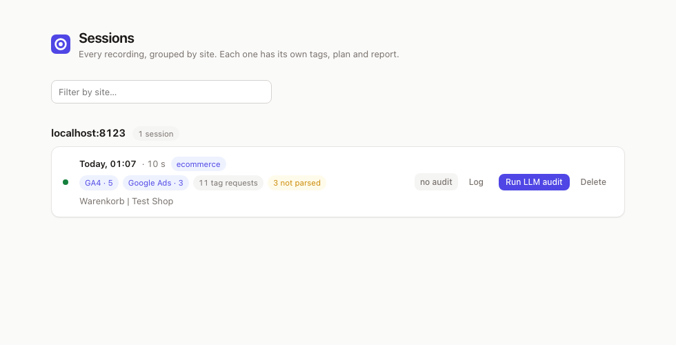
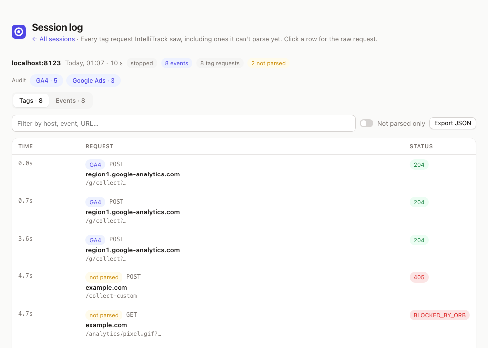
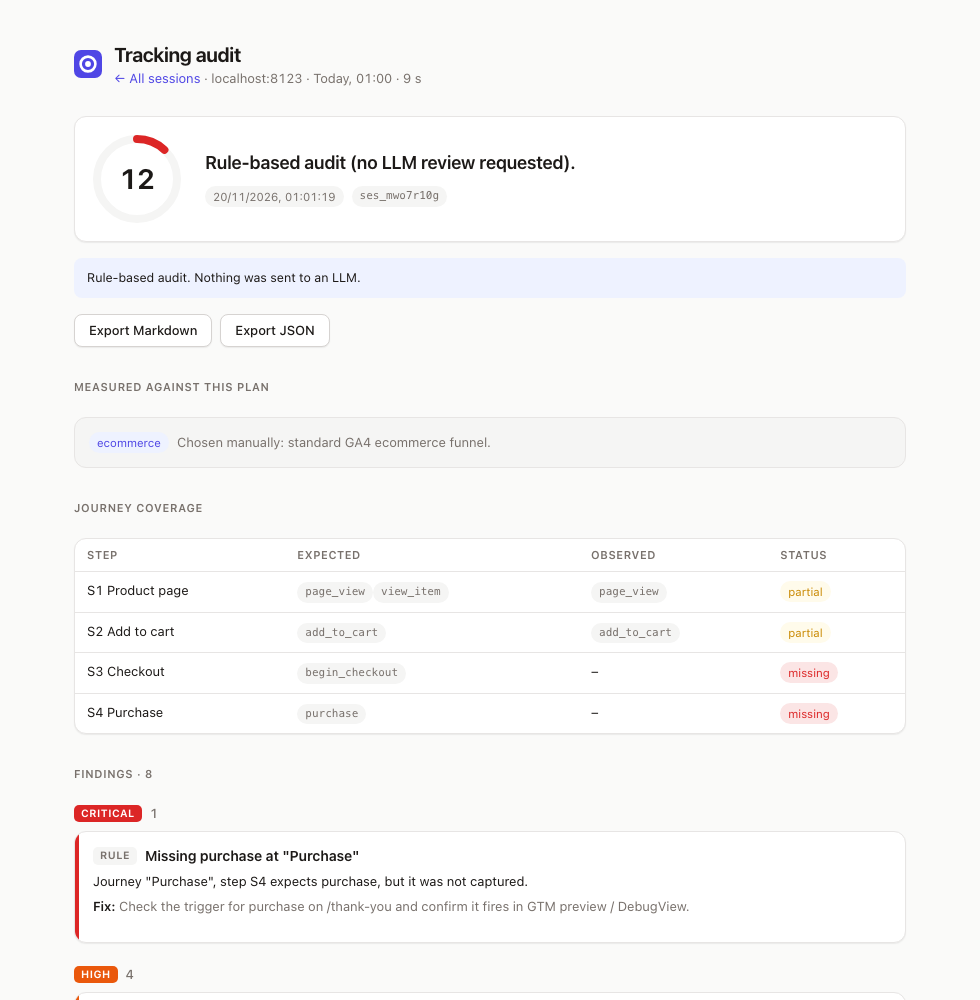

# IntelliTrack

**Audit the tracking tags on any website with your own LLM.** IntelliTrack is a Chrome extension that records the analytics tags a page fires while you click through a journey (product page → cart → checkout), shows you every raw request, and turns it into an audit: what works, what is missing, what is wrong.

- **No backend.** You bring your own LLM key (Claude, OpenAI, Gemini, or any OpenAI-compatible gateway). Requests go straight from your browser to the endpoint you configure.
- **Private by design.** Personal data is redacted before anything leaves the browser, and nothing is sent until you have previewed the exact payload and confirmed.
- **Works without an LLM too.** A built-in rule engine finds missing events, wrong values, duplicates, PII leaks, consent problems and failed hits on its own.

| | |
|---|---|
|  |  |
|  |  |

## What it checks

| Vendor | Status |
|---|---|
| **Google Analytics 4**, including server-side GTM and first-party endpoints | supported (default) |
| **Google Ads** conversions and enhanced conversions, with GA4-vs-Ads cross-checks | supported (opt-in) |
| Everything else (Meta, TikTok, Bing, Criteo, Adobe, Braze, Segment, ...) | captured and shown raw as **not parsed**; parsers are on the [backlog](kanban.md) |

Rules cover: missing events and parameters per journey step, `value` vs. items total, missing `transaction_id`/currency, duplicate conversions, double-fired events, plaintext personal data, consent signals, `client_id` changes, failed or blocked hits, and GA4/Ads mismatches.

## Install

Requires Chrome (or Edge, Brave, Arc) 116+ and Node 20+.

```bash
git clone https://github.com/eddiejaques/intellitrack.git
cd intellitrack
npm install
npm run build
```

Then in Chrome: open `chrome://extensions`, switch on **Developer mode**, click **Load unpacked** and choose the `dist/` folder. Pin IntelliTrack to the toolbar.

> After every `npm run build`, click the reload icon on the IntelliTrack card and reopen any IntelliTrack tabs. If you forget, the pages tell you the background worker is out of date.

## Quick start (5 minutes)

1. **Add your LLM** (optional). Click the toolbar icon → **⚙** → pick a provider, paste a key, **Test connection**, **Save**.
2. **Go to the site** you want to audit, in a normal tab. Open IntelliTrack and press **Start recording**. The live side panel opens next to the page.
3. **Pick the journey** IntelliTrack proposes (or choose the site type yourself) and **browse it for real**. Accept the cookie banner if there is one. Press **Mark** at each step if you want steps tied to moments in time.
4. Watch tags arrive in the side panel. Press **Stop recording**.
5. Open **Sessions**, then **Run LLM audit** (or **Preview & audit → Rules-only report** for no LLM). Review the payload, **Confirm & send**, read the report, export it as Markdown or JSON.

More detail for each of these is in **[docs/workflows.md](docs/workflows.md)**:

- [Audit a journey with your LLM](docs/workflows.md#1-audit-a-journey-with-your-llm)
- [Quick check with no LLM](docs/workflows.md#2-quick-check-with-no-llm)
- [Compare several sessions or sites](docs/workflows.md#3-compare-several-sessions-or-sites)
- [Debug a site that shows no events](docs/workflows.md#4-debug-a-site-that-shows-no-events)
- [Choose which vendors to audit](docs/workflows.md#5-choose-which-vendors-to-audit)
- [Share a result](docs/workflows.md#6-share-a-result)
- [Troubleshooting](docs/workflows.md#troubleshooting)

## Privacy

- Recording covers **the tab where you pressed Start and tabs it opens** (a product opened in a new tab, a checkout pop-up). Unrelated tabs are never recorded, and it is never always-on.
- Sessions live in your browser (IndexedDB) until you delete them. There is no telemetry.
- **Journey planning** sends only the page's *structure* (title, headings, nav labels, form field *types*, schema.org types). No form values, no URL query. You choose per site: *Always*, *Ask each time* (you see the exact JSON first) or *Never*.
- **The audit** sends a minimized, redacted payload that you preview and confirm: emails, phone numbers and hashes become shape-preserving placeholders (`[email:plaintext]`, `[sha256:64hex]`), URL queries are dropped, IDs in paths become `:id`. If the payload still looks like it contains personal data, sending is blocked.
- **Your API key is stored unencrypted** in `chrome.storage.local`. Use a dedicated key with a spending cap.
- Permissions: `webRequest` + all-sites host access (to see tag requests, including first-party server-side endpoints), `storage`, `scripting`/`activeTab` (page structure for planning), `sidePanel`, and `webNavigation` (to follow tabs that the recorded tab opens, such as a product opened in a new tab).

## Develop

```bash
npm run build       # bundle to dist/ (minified)
npm run watch       # rebuild on change
npm run typecheck   # tsc --noEmit
npm test            # vitest (unit tests, mocked chrome APIs and endpoints)
npm run eval -- --mock                       # offline eval harness self-check
npm run eval -- --config eval.config.json    # score real providers (see eval.config.example.json)
npm run kanban      # regenerate kanban.md from plan.md
```

```
extension/src/
  background/   capture, session store, planner, audit, badge   (service worker)
  content/      page-context extractor (injected on demand)
  vendors/      one file per vendor: matcher + parser           (ga4.ts, googleAds.ts)
  minimize/     noise/duplicate removal, redaction, payload
  rules/        universal, plan-driven, e-commerce, Google Ads rules
  llm/          provider adapters, JSON Schema validator, retry
  planner/      journey templates, live checklist
  ui/           popup, side panel, sessions, log view, preview, report, settings
shared/prompts/ plan_v1.md, audit_v1.md
fixtures/       seeded-fault sessions used by tests and the eval
tests/          vitest suites
```

**Add a vendor:** implement a `VendorMatcher` (`urlHint`, `match`, `parse`, `piiPolicy`) in `extension/src/vendors/`, register it in `vendors/index.ts` and `shared/vendors.ts`, and add parser tests with real captured requests. See `googleAds.ts` for a compact example.

**Workflow:** one branch per task or backlog item (`b2-datalayer`, `fix-...`), merged to `main` when its checks pass. Planning lives in [`plan.md`](plan.md) (scope, architecture, prioritized backlog); [`kanban.md`](kanban.md) is generated from it and shows progress and the next task.

## Status

All six MVP tasks (T1-T6) plus vendor selection, the Google Ads vendor, the live panel and session history are implemented and unit-tested. The "Done when" checks that need real accounts are still open: capture accuracy against GA4 DebugView on real sites, and the live-provider runs of Test connection, the planner eval and the audit eval. See [`kanban.md`](kanban.md) for the exact list and the next task.

Known limits: Chrome-family browsers only (Safari is a backlog item); a session follows tabs opened *from* the recorded tab (links with `target=_blank`, `window.open`) but not tabs you open yourself; Google Ads parameter names are written from documentation and need confirmation against live captures.

There is no license file yet; until one is added, all rights are reserved by the author.
